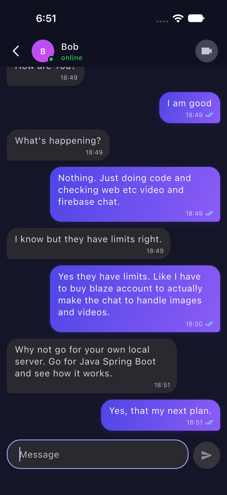
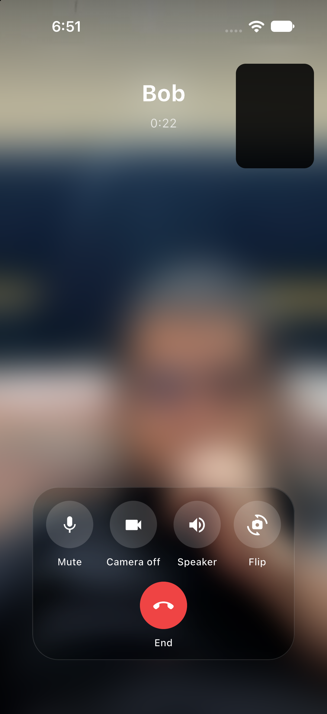
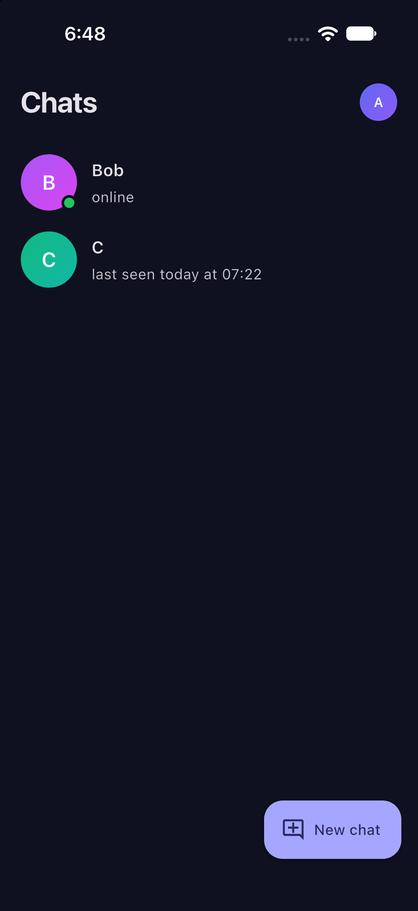
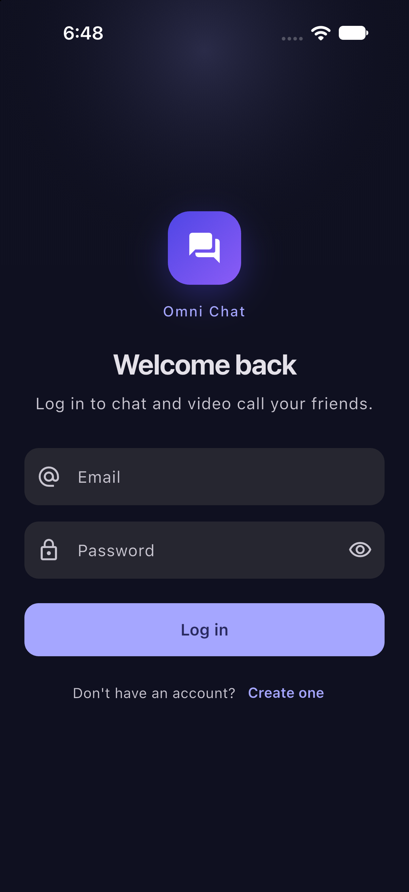
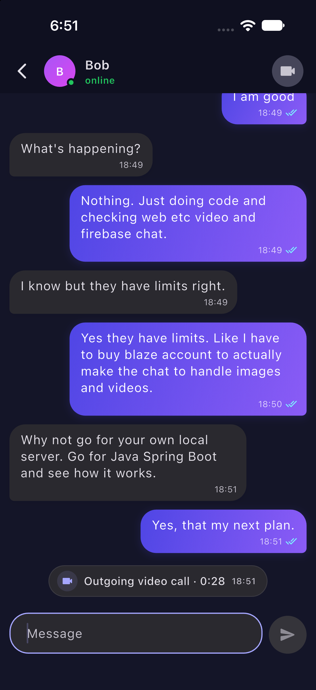
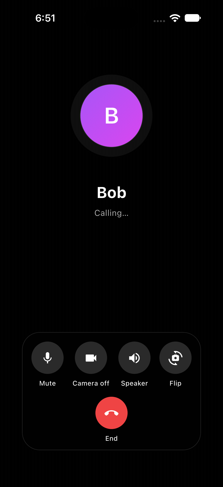
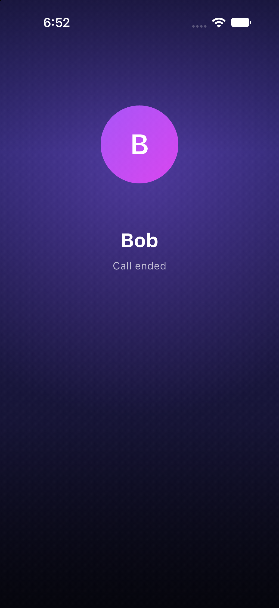

# Omni Chat

One-to-one text chat and peer-to-peer video calls, built with Flutter and Bloc on Firebase
Authentication and Realtime Database. One codebase runs on **web, Android and iOS**, and works on
the free Firebase Spark plan.

<p align="center">
  
  &nbsp;
  
  &nbsp;
  
</p>

- [Screenshots](#screenshots)
- [Features](#features)
- [How it works](#how-it-works)
- [Tech stack](#tech-stack)
- [Project structure](#project-structure)
- [Setup](#setup)
- [Running on each platform](#running-on-each-platform)
- [Tests](#tests)
- [Current limits](#current-limits)
- [Troubleshooting](#troubleshooting)
- [Roadmap](#roadmap)

## Screenshots

Taken on an iPhone in dark mode. The app also has a light theme and follows the system setting.

### Chat

| Log in | Chats | Conversation | Call in the chat |
|:---:|:---:|:---:|:---:|
|  |  |  |  |
| Email and password sign-in | Contacts with online status and last seen | Read ticks on your messages | Each call leaves an entry with its length |

### Video calls

| Calling | In a call | Call ended |
|:---:|:---:|:---:|
|  |  |  |
| Mute, camera, speaker and flip controls | Full-screen video with your own camera in the corner | Shows how the call ended |

## Features

### Accounts
- Register and sign in with email and password.
- Stays signed in between app launches.
- Signing out ends any active call and closes this account's local message database.

### Contacts and presence
- Find another user by their exact email address and start a chat.
- The home screen lists your conversations with the last message and an unread count.
- Online status and "last seen" for each contact.

### Text chat
- Messages up to 4,000 characters.
- Message status ticks: 🕓 sending → ✓ sent → ✓✓ delivered → blue ✓✓ read.
- Messages sent while offline wait and go out when the connection returns. A message that fails
  to send can be retried.
- History is kept in a local database on the device, so it loads instantly and works offline.

### Video calls
- One-to-one video calls over WebRTC (peer to peer, no media server).
- Ringing:
  - **Android:** full-screen incoming-call screen with the system ringtone.
  - **iOS:** the native CallKit call screen.
  - **Web:** an in-app ringtone, plus a browser notification when the tab is in the background.
- The caller hears a ringback tone while waiting.
- In-call controls: mute, camera on/off, switch front/back camera (mobile), and speaker/earpiece
  (mobile; calls start on the speaker).
- Handles decline, cancel, no answer (45 s timeout) and busy ("on another call").
- If the network drops, the call shows "Reconnecting…" for up to 10 seconds before ending.
- Every call leaves a line in the chat, such as "Outgoing video call · 3:12", "Missed video call"
  or "No answer".

### Offline handling
- A banner appears after about 3 seconds without a connection and hides when it returns.
- The video call button is disabled while offline.

## How it works

**Chat.** The Realtime Database (RTDB) is only a relay, not the message store. When A sends a
message to B, it is written to `inbox/{B}`. B's app saves it to its local database and deletes it
from RTDB. "Delivered" and "read" receipts travel back the same way through `receipts/{A}`. Each
device keeps its own history in a local SQLite database ([drift](https://drift.simonbinder.eu/)),
with a separate database for each account.

**Calls.** RTDB carries the call setup (offer, answer and network candidates) under
`calls/{callId}`, and `incomingCall/{uid}` tells the other user to ring. Once both sides connect,
audio and video flow directly between the two devices. Google's public STUN servers are used to
find a direct path. A TURN server can be added for networks where a direct path isn't possible
(see [TURN server](#optional-turn-server)).

**Database layout.**

| Path | Holds |
|---|---|
| `users/{uid}` | Name and email |
| `emailIndex/{key}` | Email → uid, for search |
| `userChats/{uid}/{peerUid}` | Conversation list entries |
| `presence/{uid}` | Online flag and last seen |
| `inbox/{uid}/{msgId}` | Messages waiting to be delivered (deleted once received) |
| `receipts/{uid}/{msgId}` | Delivered/read receipts waiting to be applied (deleted once applied) |
| `calls/{callId}` | Call setup and status (deleted after the call) |
| `incomingCall/{uid}` | Points the callee to a ringing call |

The security rules in `database.rules.json` make sure users can only read their own inbox,
receipts, conversation list and calls, and can't send messages or receipts in someone else's
name.

## Tech stack

| Area | Package |
|---|---|
| State management | `flutter_bloc`, `bloc_concurrency`, `equatable` |
| Backend | `firebase_auth`, `firebase_database` |
| Local storage | `drift`, `drift_flutter` (SQLite; WebAssembly on web) |
| Calls | `flutter_webrtc` |
| Native call UI | `flutter_callkit_incoming` (CallKit on iOS, full-screen intent on Android) |
| Sounds | `audioplayers` |
| Navigation | `go_router` |
| Tests | `bloc_test`, `mocktail` |

## Project structure

```
lib/
  app/                 App widget, router, dependency setup
  core/                Shared helpers: theme, RTDB paths, ICE config, widgets
  features/
    auth/              Register, login, session
    contacts/          Conversation list, search by email
    presence/          Online status and last seen
    chat/              Messages, receipts, local database
    call/              Call state machine, signaling, WebRTC, ringers, call screen
    connectivity/      Offline banner
test/                  Bloc and database tests
database.rules.json    Realtime Database security rules
web/                   sqlite3.wasm and drift_worker.js for the web database
assets/sounds/         Ringtone and ringback
```

Each feature has `data/` (the only code that talks to Firebase, drift or WebRTC), `bloc/` and
`view/`. Widgets never call Firebase directly. They send events to a bloc and draw its state.

## Setup

### Requirements

- Flutter 3.47 or newer (Dart 3.13+)
- A Firebase account (the free Spark plan is enough)
- [Firebase CLI](https://firebase.google.com/docs/cli) and FlutterFire CLI
- For iOS: a Mac with Xcode and an Apple developer account for signing. iOS 15 or newer.
- For Android: Android Studio or the Android SDK

The Firebase config files are **not** in this repo. You connect the app to your own Firebase
project.

### 1. Create a Firebase project

In the [Firebase console](https://console.firebase.google.com/):

1. Create a project.
2. In **Authentication → Sign-in method**, enable **Email/Password**.
3. In **Realtime Database**, create a database instance. Pick any location and start in locked
   mode (you'll deploy the real rules in step 3).

Create the database **before** you run `flutterfire configure`, so its URL ends up in the generated
config.

### 2. Generate the config files

From the project root:

```sh
dart pub global activate flutterfire_cli
firebase login
flutterfire configure --project=<your-project-id> --platforms=android,ios,web
```

This creates the files listed under "Firebase config" in `.gitignore`:

- `lib/firebase_options.dart`
- `android/app/google-services.json`
- `ios/Runner/GoogleService-Info.plist`
- `firebase.json`

Check that each of them contains your database URL
(`https://<your-project-id>-default-rtdb.firebaseio.com`, or a regional URL ending in
`firebasedatabase.app`). If one is missing it, the app crashes at startup with a `duplicate-app`
error. Add it by hand:

| File | Key |
|---|---|
| `lib/firebase_options.dart` | `databaseURL:` in each platform's `FirebaseOptions` |
| `android/app/google-services.json` | `"firebase_url"` under `project_info` |
| `ios/Runner/GoogleService-Info.plist` | `<key>DATABASE_URL</key>` |

> If you change the app's bundle ID / application ID (they are still `com.example.*`), do it
> **before** running `flutterfire configure`, or run it again afterwards.

### 3. Deploy the database rules

Add the rules file to the generated `firebase.json`:

```json
"database": {
  "rules": "database.rules.json"
}
```

Then deploy:

```sh
firebase deploy --only database --project=<your-project-id>
```

Deploy the rules before you put any real data in the database. Without them, the database is
either locked (nothing works) or open to everyone.

### 4. Install packages and run

```sh
flutter pub get
flutter run -d chrome
```

To try chat and calls you need two accounts signed in at the same time, for example two browser
profiles, or a browser and a phone.

### Optional: TURN server

With STUN only, most calls connect, but some fail on strict networks (often mobile data, office
or hotel Wi‑Fi): they stay on "Connecting…" and then end. A TURN server relays the call in those
cases. Pass one at build time:

```sh
flutter run \
  --dart-define=TURN_URL=turn:your.turn.host:3478 \
  --dart-define=TURN_USER=username \
  --dart-define=TURN_PASS=password
```

The setting lives in `lib/core/ice_config.dart`. Use a hosted service (for example Metered or
Cloudflare) or run your own [coturn](https://github.com/coturn/coturn). The free public TURN
lists found online are almost all dead. Anything passed this way is built into the app, so treat
the credentials as public and use a service with usage limits.

## Running on each platform

### Web

```sh
flutter run -d chrome
```

- Allow camera, microphone and notification access when the browser asks.
- Camera access needs `localhost` or HTTPS.
- The local database runs on WebAssembly using `web/sqlite3.wasm` and `web/drift_worker.js`.
  Keep both files when you deploy.
- Build for hosting with `flutter build web`.

### Android

```sh
flutter run -d <device-id>
```

- Asks for camera, microphone and notification permission on first use. Allow full-screen
  notifications if asked, so incoming calls can show over the lock screen.
- Release builds are still signed with the debug key. Set up your own signing config in
  `android/app/build.gradle.kts` before publishing.

### iOS

```sh
flutter run -d <device-id>
```

- Plugins are installed through Swift Package Manager (there is no Podfile).
- Open `ios/Runner.xcworkspace` in Xcode once and choose your own team under
  **Signing & Capabilities**.
- **Use a physical device for calls.** The simulator has no camera and no CallKit screen.
- Incoming calls use CallKit, so they appear like phone calls (including in the Recents list).

## Tests

```sh
flutter analyze
flutter test
```

There are 63 tests. Every bloc is covered with `bloc_test` and mocked repositories, plus tests for
the local database.

## Current limits

These are known limits of v1, mostly from staying on the free Spark plan (no Cloud Functions or
Cloud Storage).

**Calls**
- **Calls only ring while the app is open.** There are no push notifications, so a closed app
  can't receive a call. Android may keep ringing for a short while after the app goes to the
  background. iOS suspends background apps within seconds, so in practice the callee needs the
  app open. On web, the tab must be open.
- Video calls only. There is no audio-only call, and a call needs both camera and microphone
  access.
- One-to-one only, and one call at a time. No group calls, screen sharing or call waiting.
- STUN only by default, so some network combinations can't connect without a TURN server.
- Call quality depends on both users' connections, because there is no media server.

**Chat**
- Text only. No images, video, voice notes or files (these need Firebase Storage on the paid
  Blaze plan).
- **History lives only on the device.** Signing in on a new phone or browser starts with an
  empty history, and clearing browser data or uninstalling the app deletes it. There is no
  backup or sync between devices.
- If you use the same account on two devices at once, only the first device to receive a
  message keeps it.
- No group chats, message editing or deleting, typing indicator, reactions or replies.
- Messages are limited to 4,000 characters.

**Accounts and contacts**
- Email and password only. No password reset, email verification, social login, profile editing
  or account deletion.
- Users are found by **exact** email address only. There is no name search or contact import.
- No blocking or reporting.

**Platforms and quotas**
- Web, Android and iOS only. Desktop (macOS, Windows, Linux) is not set up.
- The Spark plan limits the Realtime Database to 100 users connected at the same time,
  1 GB stored and 10 GB downloaded per month. Messages and calls are deleted from RTDB once
  delivered, so storage stays small. Check the
  [current Firebase pricing](https://firebase.google.com/pricing) for exact numbers.

## Troubleshooting

| Problem | Fix |
|---|---|
| App crashes at startup with `duplicate-app` | One of the config files is missing the database URL. See [step 2](#2-generate-the-config-files). |
| `permission-denied` errors, or search finds nobody | The database rules aren't deployed. See [step 3](#3-deploy-the-database-rules). |
| Call stays on "Connecting…" and then fails | The two networks can't connect directly. Add a [TURN server](#optional-turn-server), or test both devices on the same Wi‑Fi. |
| "Camera or microphone access was denied" | Allow camera and microphone for the app (or the site, on web) in system or browser settings. |
| Incoming call doesn't ring | The callee's app must be open (see [Current limits](#current-limits)). On Android, check notification and full-screen permissions. |
| No incoming call notification on web | Allow notifications for the site. The notification only appears when the tab is in the background. |
| Web build can't open the local database | Make sure `sqlite3.wasm` and `drift_worker.js` are served from the web root. |

## Roadmap

Planned once the project moves beyond the free plan:

- Ringing when the app is closed (FCM on Android, VoIP push with PushKit on iOS), using Cloud
  Functions or a small server.
- Image and video messages with Firebase Storage.
- A TURN server set up by default, with short-lived credentials.
